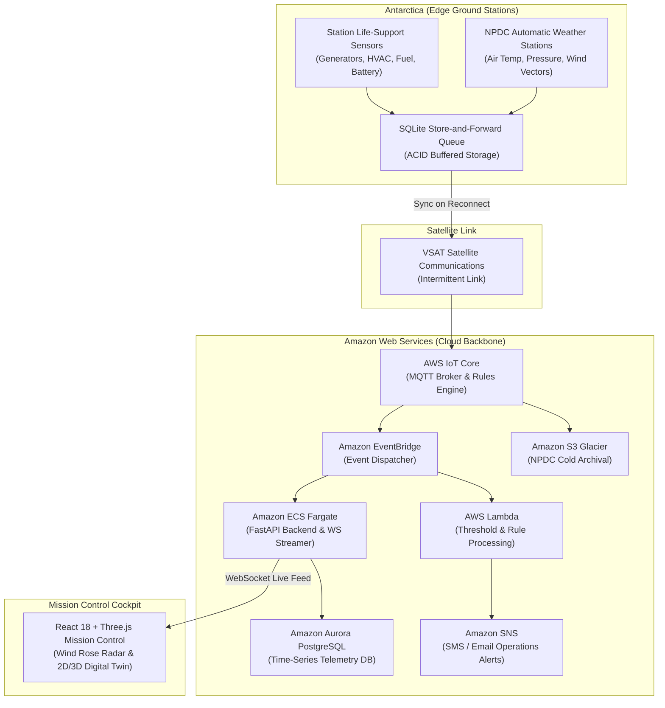
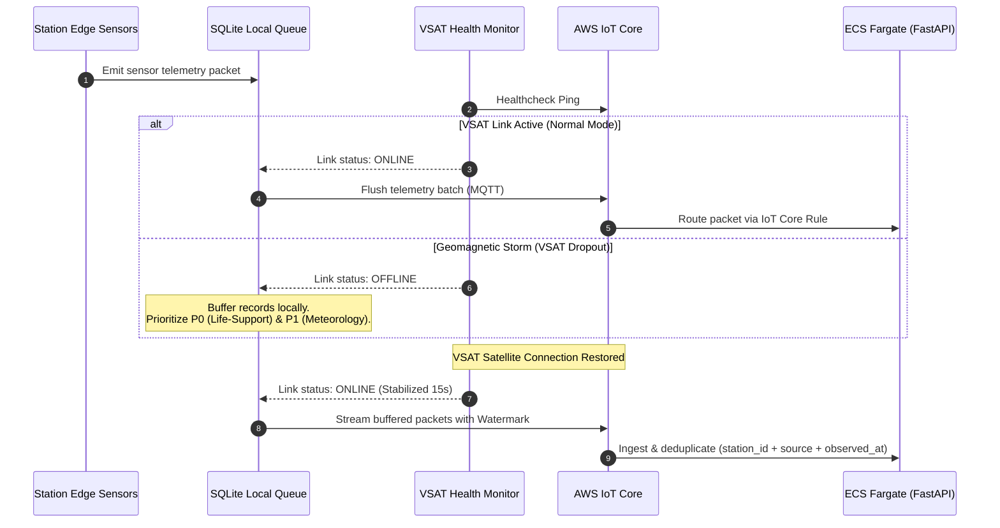

# 🏗️ Dhruv Drishti — Deep System Architecture Specification
### Cloud-Native Polar Digital Twin & Life-Support Intelligence Architecture

---

## 1. High-Level Edge-to-Cloud Topology

---

## 2. Satellite Blackout & Store-and-Forward Sequence

During geomagnetic solar storms or severe blizzard whiteouts, the station VSAT satellite link experiences intermittent dropouts. Dhruv Drishti guarantees zero telemetry loss via local ACID store-and-forward:

---

## 3. Dual-Layer Isolation Forest Anomaly Pipeline

Dhruv Drishti isolates environmental shocks from mechanical failures through dual independent machine learning inference pipelines:

1. **Layer 1: Environmental / Atmospheric Anomaly Detector**:
   - **Inputs**: Barometric pressure ($P$), 1-hour pressure rate-of-change ($\Delta P / \Delta t$), ambient temperature ($T$), circular wind vector $(\sin \theta, \cos \theta)$, wind velocity ($V$), relative humidity ($RH$).
   - **Classifications**: `RAPID_PRESSURE_DROP`, `HIGH_WIND_EVENT`, `EXTREME_COLD_EVENT`, `SENSOR_FREEZE`.
   - **Objective**: Forecast blizzard impact 45 minutes prior to visual onset.

2. **Layer 2: Machinery Life-Support Anomaly Detector**:
   - **Inputs**: Generator shaft RPM, bearing vibration ($mm/s$), HVAC refrigerant line pressure ($bar$), fuel flow rate ($L/h$), battery state-of-charge ($SOC\%$).
   - **Classifications**: `BEARING_DEGRADATION`, `GENERATOR_COLLAPSE`, `FUEL_LEAK`, `HVAC_DEPRESSURIZATION`.
   - **Objective**: Preempt critical mechanical failure before life-support systems fail.

---

  <b>Dhruv Drishti System Architecture</b> | <i>Built for AWS Environmental Hacks 2026</i>

